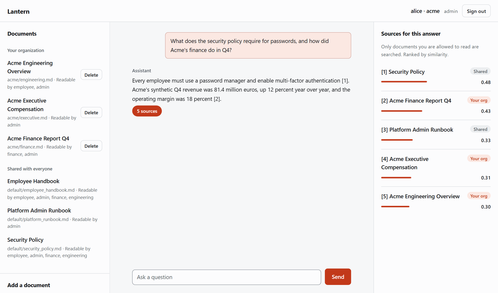
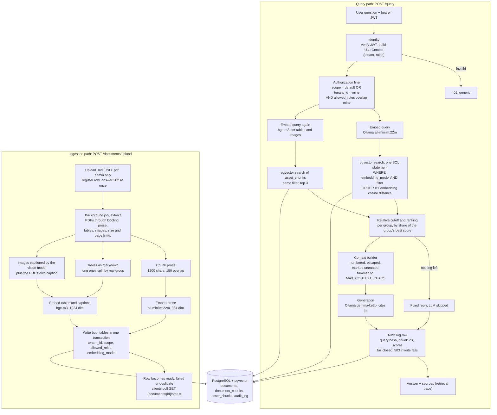

# lantern-rag

> Permission-aware, multi-tenant RAG: answers only from documents you may read. FastAPI, pgvector, Ollama, Docling.



**Lantern** answers questions over **shared documents** (visible to every organization) and **tenant documents** (visible only to the organization that uploaded them). Authorization is enforced inside the vector query itself, one SQL statement over PostgreSQL + pgvector, so text a user may not read never reaches the LLM.

```text
JWT → verified identity → authorization filter → filtered vector search → context → LLM → answer + audit
```

## Features

- **Chat UI** at `/app/` (landing page at `/`): ask questions, upload and delete documents, watch uploads index in the background, and see the *retrieval trace* of every answer (which passages, tables and figures were used, shared or yours, with scores).
- **PDFs with tables and figures**: parsed with Docling. Prose, tables (Markdown) and images (vision-model captions) are indexed separately, the last two with their own embedding model.
- **Accounts**: lockout after 3 failed logins with an emailed reset link, token revocation (logout, reset, deactivation), per-tenant rate limit.
- **Isolation you can measure**: an adversarial suite scores leakage against an independent oracle (`python -m evaluation.security_eval`), and a test proves it fails when isolation is removed.
- **Operations**: append-only audit log, JSON logs with request ids, Prometheus metrics. API docs at `/docs`.

## Access model

| Scope | Who can retrieve it | Who can add it |
|---|---|---|
| `tenant` | Users of the owning organization whose roles intersect the document's `allowed_roles` | The organization's `admin` (tenant taken from their token) |
| `default` | Every organization, subject to `allowed_roles` | Only `platform-admin` |

The filter is `(scope = default OR tenant_id = caller's tenant) AND caller's roles ∩ allowed_roles ≠ ∅`, built in one place (`app/retrieval/filters.py`) from the verified token. Tenant, scope and roles are never read from a request body, query string or form field.

## Quick start

Needs Docker and [Ollama](https://ollama.com) on the host.

```bash
ollama pull all-minilm:22m   # prose embeddings (384 dim)
ollama pull bge-m3           # table and image-caption embeddings (1024 dim)
ollama pull gemma4:e2b       # chat model, also captions images
cp .env.example .env         # set POSTGRES_PASSWORD and a real JWT_SECRET_KEY
docker compose up --build    # postgres + api + demo data + prometheus
```

Open `http://127.0.0.1:8000/` and sign in as `alice` (organization `acme`, admin), `bob` (`acme`, employee), `erin` (`globex`, admin) or `root` (`platform`, platform-admin). The demo password is in `scripts/seed_db.py`; seeding only runs when `APP_ENV=development`.

Compose uses the Ollama already running on your machine, so no model is downloaded twice. It publishes only the API (`127.0.0.1:8000`) and Prometheus (`127.0.0.1:9090`). A self-contained variant with its own Ollama container is `OLLAMA_URL_DOCKER=http://ollama:11434 docker compose --profile bundled-ollama up --build` (downloads several GB; not run to completion). More in [docs/design-notes.md](docs/design-notes.md).

**Without Compose** (Python 3.12+, [uv](https://docs.astral.sh/uv/), PostgreSQL with [pgvector](https://github.com/pgvector/pgvector) 0.5+; the `pgvector/pgvector:pg17` image is the easy way):

```bash
docker run -d --name rag-pgvector -e POSTGRES_PASSWORD=<password> -e POSTGRES_DB=permission_aware_rag \
  -p 127.0.0.1:5433:5432 -v rag_pgvector_data:/var/lib/postgresql/data pgvector/pgvector:pg17
# in .env: POSTGRES_HOST=127.0.0.1 (not localhost: Windows tries IPv6 first and stalls ~2 s per connection), POSTGRES_PORT=5433
uv sync --all-groups
uv run python -m app.db.migrate            # forward-only SQL migrations
uv run python -m scripts.seed_db           # demo tenants and users
uv run python -m scripts.ingest_documents  # demo corpus
uv run uvicorn app.main:app --reload       # http://127.0.0.1:8000
```

The first PDF upload downloads the Docling models (a few hundred MB, once). PDF parsing runs on CPU: tens of seconds for a short PDF, a few minutes for a figure-heavy paper.

## Development

```bash
uv run pytest                               # unit, integration (needs Postgres + pgvector), security
uv run pytest -m slow                       # real Docling conversion (about 30 s, off by default)
uv run ruff check .
uv run python -m evaluation.security_eval   # exits non-zero on any leakage
uv run python -m evaluation.retrieval_eval  # Recall, Precision, MRR, NDCG
uv run python -m evaluation.table_eval      # table serialization comparison
```

Integration tests use a throwaway schema and skip when Postgres or pgvector is unreachable, so check `pytest -rs` before trusting a green run. Changing an embedding model or dimension needs a migration (`document_chunks.embedding` is `vector(384)`, `asset_chunks.embedding` is `vector(1024)`) and re-embedding; every chunk records its `embedding_model`, so vectors from different models never mix.

## Architecture

Every query follows one fixed order: identity, authorization, filtered retrieval, context, LLM.



| Concern | Module | Notes |
|---|---|---|
| Identity | `app/auth` | JWT validation, Argon2 passwords, lockout and email reset, token revocation; any token failure is a generic 401 |
| Rate limiting | `app/ratelimit.py` | Sliding window per tenant, 429 with `Retry-After` |
| Authorization | `app/retrieval/filters.py` | The only place scope, tenant and role filters are built |
| Retrieval | `app/retrieval` | `PgVectorRetriever` takes the filter as a required argument of every read; `CombinedRetriever` searches prose and asset tables with the same filter |
| Ingestion | `app/ingestion` | Docling parsing, chunking, image captions, background upload jobs, checksum de-duplication, per-upload status |
| Generation | `app/generation` | Ollama; prompts escape and delimit retrieved text and mark it untrusted; the LLM is skipped when nothing is retrievable |
| Audit | `app/audit` | Append-only `audit_log`; a failed audit write fails the request |
| Observability | `app/observability` | Request ids, JSON logs, Prometheus metrics |
| Persistence | `app/db` | Forward-only SQL migrations, asyncpg pool |

## Configuration

Environment variables or `.env` (see `.env.example`).

| Setting | Default | Purpose |
|---|---|---|
| `EMBEDDING_MODEL` / `_DIMENSION` | `all-minilm:22m` / 384 | Prose embeddings; must match `vector(384)` |
| `ASSET_EMBEDDING_MODEL` / `_DIMENSION` | `bge-m3` / 1024 | Tables and image captions; must match `vector(1024)` |
| `LLM_MODEL`, `VISION_MODEL` | `gemma4:e2b` | Answers; image captions |
| `TOP_K`, `ASSET_TOP_K`, `RETRIEVAL_RELATIVE_CUTOFF` | 20, 3, 0.4 | Retrieval breadth and relevance cutoff |
| `LOGIN_MAX_ATTEMPTS`, `PASSWORD_RESET_TTL_MINUTES` | 3, 30 | Lockout and reset-link lifetime |
| `TENANT_RATE_LIMIT_PER_MINUTE` | 120 | Per tenant; 0 turns it off |
| `SMTP_HOST`, `_PORT`, `_USER`, `_PASSWORD`, `_FROM`, `PUBLIC_BASE_URL` | unset | Reset emails; without `SMTP_HOST` development logs the link |
| `MAX_UPLOAD_BYTES`, `CHUNK_SIZE_CHARS`, `CHUNK_OVERLAP_CHARS` | 10 MB, 1200, 150 | Upload and chunk limits |
| `JWT_SECRET_KEY`, `APP_ENV`, `METRICS_TOKEN` | | Signing key (32+ random characters outside development), environment, `/metrics` auth |

## Security

| Threat | Mitigation | Evidence |
|---|---|---|
| Reading another tenant's or a restricted document | The filter is bound SQL parameters inside the vector query, from the verified token | `tests/security/test_vector_isolation.py`, `evaluation/security_eval.py` |
| Client-supplied tenant or roles, forged or expired tokens | Identity only from the signed token; algorithm and claims pinned | `tests/security/test_spoofing.py` |
| Tenant admin publishing to other tenants | Shared ingestion needs the separate `platform-admin` role | `tests/security/test_document_scope_api.py` |
| Prompt injection in a document or image | Retrieved text is escaped, delimited and declared untrusted; authorization never depends on the model | `tests/security/test_prompt_injection.py` |
| Malicious or oversized uploads | Type allow-list, size, page, time and text limits; filenames never touch disk | `tests/unit/test_loaders.py` |
| Brute-force login, stolen tokens | Lockout, single-use hashed reset tokens, revocation | `tests/security/test_account_security.py` |
| Tampering with the audit trail | A trigger rejects `UPDATE` and `DELETE` on `audit_log` | `tests/integration/test_migrations.py` |
| Leakage through logs or metrics | Ids and counts only; no tenant, user or query text in labels | `tests/unit/test_observability.py` |

Main limits (full list with numbers in [docs/design-notes.md](docs/design-notes.md)):

- Roles are in the token, so role changes apply at next login; a token also stops on logout, password reset or deactivation.
- The locked-account response confirms the account exists, and anyone who knows a username can lock it; the reset email is the recovery path.
- Rate limits and upload jobs live in the API process: per worker, and a restart abandons running jobs. Use a queue before scaling out.
- PDFs are parsed in-process on CPU with OCR off; scanned PDFs come back empty.
- Table and image relevance is not benchmarked, and image captions are model output that can be wrong.
- Reranking is a deliberate TODO until the corpus is large enough to need it.
- `/metrics` is open unless `METRICS_TOKEN` is set; the audit log stores a hash of each query, not its text.

The design and phase plan live in `permission_aware_multi_tenant_rag_implementation_plan.md`.
