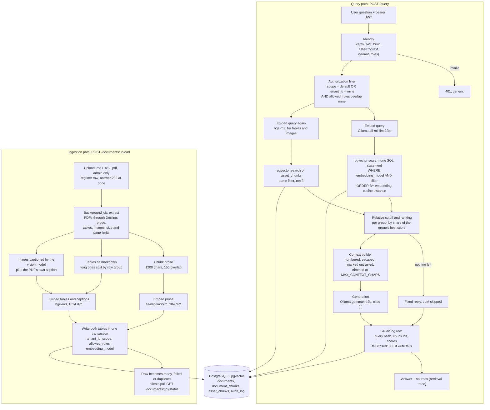

# lantern-rag

> Permission-aware, multi-tenant RAG: answers only from documents you may read. FastAPI, pgvector, Ollama, Docling.

**Lantern** is a FastAPI service that answers questions over a mix of **shared documents** (visible to every organization) and **tenant documents** (visible only to the organization that uploaded them). Authorization is enforced inside the vector query itself (a single SQL statement over PostgreSQL + pgvector), so text a user may not read never reaches the LLM.

```text
JWT → verified identity → authorization filter → filtered vector search → context → LLM → answer + audit
```

## What you get

- **Landing page** at `/` and **chat UI** at `/app/`: sign in, ask questions, upload and delete documents, reset a locked account by email, watch uploads index in the background, and see the *retrieval trace* for every answer (which documents, passages, tables and figures were used, whether each is shared or your organization's, and its similarity score).
- **PDFs with tables and figures** — PDFs are parsed with Docling. Prose, tables and images are indexed separately: tables as Markdown, images through a vision-model caption, both embedded with a second model in their own vector table.
- **API** — `POST /auth/login`, `POST /auth/logout`, `POST /auth/password-reset/request` and `/confirm`, `POST /query`, `GET /documents`, `GET /documents/uploads`, `GET /documents/{id}/status`, `DELETE /documents/{id}`, `POST /documents` (+ `/upload`), `POST /documents/default` (+ `/upload`), `GET /audit`, `GET /metrics`, `GET /health`. Interactive docs at `/docs`.
- **Isolation you can measure** — an adversarial suite scores leakage against an independent oracle (`uv run python -m evaluation.security_eval`), and a companion test proves the suite fails when tenant isolation is removed.
- **Operability** — append-only audit log, JSON logs with request ids and Prometheus metrics.

## Access model

| Document scope | Who can retrieve it | Who can add it |
|---|---|---|
| `tenant` | Users of the owning organization whose roles intersect the document's `allowed_roles` | An organization's `admin` (organization taken from their token) |
| `default` | Every organization, subject to `allowed_roles` | Only `platform-admin` (a role no tenant admin holds) |

Retrieval scope is `(scope = default OR tenant_id = caller's tenant) AND caller's roles ∩ allowed_roles ≠ ∅`, built in one place (`app/retrieval/filters.py`) from the verified token. Tenant, scope, and roles are never read from a request body, query string, or form field.

## Run it

Prerequisites: Python 3.12+, [uv](https://docs.astral.sh/uv/), PostgreSQL **with the [pgvector](https://github.com/pgvector/pgvector) extension** (0.5+; 0.8+ recommended), and [Ollama](https://ollama.com) on the host.

Create the extension once as a superuser, then run migrations as the application user:

```sql
CREATE EXTENSION IF NOT EXISTS vector;
```

The migration also runs `CREATE EXTENSION IF NOT EXISTS`, which only succeeds if the server has pgvector installed and the role may create it. The simplest way to get a pgvector-enabled server is the `pgvector/pgvector:pg17` Docker image, which is what Compose uses. For local development without Compose:

```bash
docker run -d --name rag-pgvector -e POSTGRES_PASSWORD=<your password> -e POSTGRES_DB=permission_aware_rag \
  -p 127.0.0.1:5433:5432 -v rag_pgvector_data:/var/lib/postgresql/data pgvector/pgvector:pg17
```

then set `POSTGRES_PORT=5433` and `POSTGRES_HOST=127.0.0.1` in `.env` (prefer the IP over `localhost` on Windows, where IPv6 is tried first and each new connection stalls about two seconds).

```bash
ollama pull all-minilm:22m                # prose embeddings, 384 dimensions
ollama pull bge-m3                         # table and image-caption embeddings, 1024 dimensions
ollama pull gemma4:e2b                     # chat model, also captions images (LLM_MODEL, VISION_MODEL)
cp .env.example .env                       # then set POSTGRES_PASSWORD and a real JWT_SECRET_KEY
uv sync --all-groups
uv run python -m app.db.migrate            # creates tables in the database named by POSTGRES_DB
uv run python -m scripts.seed_db           # demo tenants acme/globex and users (development only)
uv run python -m scripts.ingest_documents  # demo corpus through the real stack
uv run uvicorn app.main:app --reload       # http://127.0.0.1:8000
```

The first PDF upload downloads the Docling layout and table models from Hugging Face (a few hundred MB, once; `uv run docling-tools models download layout tableformer` fetches them ahead of time). PDF parsing runs on CPU: a short PDF takes tens of seconds and a figure-heavy paper a few minutes, because each figure is captioned by the vision model.

The seed script prints no credentials; demo users (`alice`, `bob`, `carol` in `acme`; `dave`, `erin` in `globex`; `root` in `platform`) share the development password defined in `scripts/seed_db.py`. The script refuses to run unless `APP_ENV=development`.

Whole stack in one command (needs only Docker and a filled-in `.env`; stop any `uvicorn` already on port 8000 first):

```bash
docker compose up --build
```

It starts `postgres` (pgvector), the `api` (which migrates first), a one-shot `seed` that loads the demo tenants, users and corpus (only when `APP_ENV=development`), and `prometheus`. **Ollama is the one already running on your machine**, reached through `host.docker.internal`, so no model is downloaded again. It needs `EMBEDDING_MODEL`, `ASSET_EMBEDDING_MODEL`, `LLM_MODEL` and `VISION_MODEL` pulled (see the `ollama pull` lines above). Then open `http://127.0.0.1:8000/` and sign in with the demo accounts from `scripts/seed_db.py`.

For a self-contained stack with its own Ollama container, which downloads the models into the `ollama_data` volume on first start (several GB, slow), use the `bundled-ollama` profile:

```bash
OLLAMA_URL_DOCKER=http://ollama:11434 docker compose --profile bundled-ollama up --build
```

Compose publishes only the API (`127.0.0.1:8000`) and Prometheus (`127.0.0.1:9090`); Postgres (which also holds the vectors) is reachable only from inside the Compose network. The API image is built in two stages (dependencies and model weights are installed in a builder; only the virtualenv and the weights are copied into the final image) and bundles CPU-only PyTorch and the Docling weights, about 2.5 GB of layers (Docker Desktop reports 3.7 GB), so a PDF upload never downloads anything at runtime. `docker compose down` keeps data, `docker compose down -v` deletes it. Compose uses its own database volume, separate from a development container started with `docker run` above.

**Verified with the default setup:** images build; Postgres, API and Prometheus come up healthy; the seed job embeds the demo corpus through the host Ollama; a login, a cited answer, tenant isolation (a second organization cannot see the first one's PDF), a PDF upload with one table and one image, a table question answered from the table, the audit log and the Prometheus scrape all work. The `bundled-ollama` profile is configured but I have not run it to completion.

## Development

```bash
uv run pytest                               # unit, integration (needs Postgres), and security tests
uv run ruff check .
uv run python -m evaluation.security_eval   # exits non-zero on any leakage
uv run python -m evaluation.retrieval_eval  # Recall@K, Precision@K, MRR, NDCG@K
uv run python -m evaluation.table_eval      # table serialization comparison (needs the asset model in Ollama)
uv run pytest -m slow                       # real Docling conversion of tests/fixtures/report.pdf (about 30 s, off by default)
```

Integration tests create a throwaway schema in the configured Postgres database and are skipped when it is unreachable; pgvector is required, and without the extension they skip, so check `pytest -rs` before trusting a green run. Embeddings and generation are pluggable behind `Embedder` and `LLMProvider`; changing an embedding model or its dimension requires a migration (`document_chunks.embedding` is `vector(384)`, `asset_chunks.embedding` is `vector(1024)`) and re-embedding; every chunk also records its `embedding_model`, and search only matches chunks from the configured model, so vectors from different models never mix.

## Architecture

Every query follows one fixed order: identity, authorization, filtered retrieval, context, LLM. Ingestion feeds the same tables that retrieval reads.



| Concern | Module | Notes |
|---|---|---|
| Identity | `app/auth` | JWT validation, Argon2 password hashing, login with lockout, email password reset, token revocation. Any token failure returns a generic 401. |
| Rate limiting | `app/ratelimit.py` | Sliding window per tenant (`TENANT_RATE_LIMIT_PER_MINUTE`, default 120, 0 = off), applied to every authenticated request after the token is verified; over the limit is 429 with `Retry-After`. |
| Authorization | `app/retrieval/filters.py` | The single place scope/tenant/role filters are built. |
| Retrieval | `app/retrieval` | `RetrievalService` always applies the filter; `PgVectorRetriever` takes the filter as a required argument of every read and renders it as a parameterized `WHERE` clause. `CombinedRetriever` searches `document_chunks` (prose) and `asset_chunks` (tables, images) with the same filter. |
| Ingestion | `app/ingestion` | `.md`/`.txt` decoding and PDF parsing with Docling (prose, tables, images) under size, page, time and text limits; prose chunking; image captioning (`captioner.py`); background upload jobs (`uploads.py`); Postgres registry with checksum de-duplication and per-upload status. |
| Generation | `app/generation` | Provider interface (Ollama today); prompts delimit and escape retrieved text and mark it untrusted; the LLM is skipped when nothing is retrievable. |
| Audit | `app/audit` | Append-only `audit_log`; a failed audit write fails the request rather than returning an unaudited answer. |
| Observability | `app/observability` | Request ids, JSON logs, Prometheus metrics. |
| Persistence | `app/db` | Forward-only SQL migrations (`app/db/migrations`), asyncpg pool. |

## Configuration

All settings come from environment variables or `.env` (see `.env.example`).

| Setting | Default | What it does |
|---|---|---|
| `EMBEDDING_MODEL` / `EMBEDDING_DIMENSION` | `all-minilm:22m` / 384 | Prose embeddings; must match the `vector(384)` column |
| `ASSET_EMBEDDING_MODEL` / `ASSET_EMBEDDING_DIMENSION` | `bge-m3` / 1024 | Table and image-caption embeddings; must match `vector(1024)` |
| `VISION_MODEL`, `LLM_MODEL` | `gemma4:e2b` | Image captions; answers |
| `TOP_K`, `ASSET_TOP_K`, `RETRIEVAL_RELATIVE_CUTOFF` | 20, 3, 0.4 | Retrieval breadth and the per-group relevance cutoff |
| `LOGIN_MAX_ATTEMPTS`, `PASSWORD_RESET_TTL_MINUTES` | 3, 30 | Account lockout and reset-link lifetime |
| `TENANT_RATE_LIMIT_PER_MINUTE` | 120 | Requests per tenant per minute; 0 turns it off |
| `SMTP_HOST`, `SMTP_PORT`, `SMTP_USER`, `SMTP_PASSWORD`, `SMTP_FROM`, `PUBLIC_BASE_URL` | unset | Reset emails; without `SMTP_HOST`, development logs the link and other environments send nothing |
| `MAX_UPLOAD_BYTES`, `CHUNK_SIZE_CHARS`, `CHUNK_OVERLAP_CHARS` | 10 MB, 1200, 150 | Upload and prose-chunk limits |
| `METRICS_TOKEN`, `JWT_SECRET_KEY`, `APP_ENV` | | Metrics auth, token signing key (32+ random characters outside development), environment |

## Threat model

Assets: tenant documents and their derived vectors, shared documents restricted by role, credentials and tokens, and the audit trail.

| Threat | Mitigation | Evidence |
|---|---|---|
| A user reads another tenant's documents | Filter rendered as bound SQL parameters inside the vector query, from the verified token; no code path queries without it | `tests/security/test_vector_isolation.py`, `tests/integration/test_filter_sql.py`, `evaluation/security_eval.py` |
| A user reads a role-restricted document | `allowed_roles` intersection in the same filter | same |
| Client supplies its own tenant or roles | Identity comes only from the signed token; bodies, query strings, and form fields are ignored | `tests/security/test_spoofing.py` |
| Forged, unsigned, expired, or malformed tokens | Algorithm pinned, issuer and required claims enforced, `alg: none` rejected | `tests/security/test_spoofing.py` |
| Tenant admin publishes to other tenants | Default-scope ingestion requires the separate `platform-admin` role | `tests/security/test_document_scope_api.py` |
| Prompt injection inside a document | Retrieved text is escaped, delimited, and declared untrusted; authorization never depends on the model | `tests/security/test_prompt_injection.py` |
| Leakage through logs, traces, or metrics | Logs carry ids and counts only; metric labels exclude tenant, user, and query text | `tests/unit/test_observability.py` |
| Malicious or oversized uploads | Type allow-list, size cap, PDF page, time and text limits, damaged or encrypted PDFs rejected, filenames never touch disk | `tests/unit/test_loaders.py`, `tests/security/test_document_upload_api.py` |
| Tampering with the audit trail | Database trigger rejects `UPDATE` and `DELETE` on `audit_log` | `tests/integration/test_migrations.py` |
| Direct access to the database | The Postgres port is not published by Compose | `docker-compose.yml` |
| Weak secrets in production | The app refuses to start outside development with a short or placeholder `JWT_SECRET_KEY` | `app/config.py` |

Known limits and residual risk:

- **Role changes take effect at the next login.** Roles are embedded in the token (default lifetime 60 minutes). A token stops working earlier only when it is signed out (`POST /auth/logout`, a `revoked_tokens` denylist keyed by `jti`), the user is deactivated, or their password is reset. A token issued in the same second as a reset is not revoked (`iat` has one-second resolution).
- **The audit log stores a SHA-256 hash of each query, not its text.** A hash of a short query can be guessed offline; treat it as pseudonymized, not anonymous.
- **`/metrics` is unauthenticated by default.** Keep it on an internal network or set `METRICS_TOKEN`. Metrics contain no tenant or user labels.
- **Lockout and reset.** After `LOGIN_MAX_ATTEMPTS` (3) failed sign-ins an account is locked until its owner completes a password reset by email (`POST /auth/password-reset/request`, then the emailed single-use link, valid `PASSWORD_RESET_TTL_MINUTES`, stored only as a SHA-256 hash). The locked response (423) confirms that the account exists, and anyone who knows a username can lock that account by failing three times; the reset email is the recovery path. Unknown usernames are never counted. Email needs `SMTP_HOST` (and `SMTP_USER`/`SMTP_PASSWORD`/`SMTP_FROM`); without it, development logs the link and other environments send nothing.
- **Tenant rate limits are per process.** With several API workers each keeps its own window, so a tenant gets the limit times the worker count; move the window into Redis or Postgres before scaling out. Per-IP throttling of the login endpoint is not built; use a gateway.
- **Deleting a document** (`DELETE /documents/{id}`, admins) removes its registry row and, by cascade, all of its vectors. It matches the document id and the caller's tenant together, so another tenant's or a shared document answers 404; shared documents need `platform-admin`. File names are not unique within a tenant, so the id (shown in the UI list next to the file name) is the key.
- **TODO: reranking.** Not built on purpose. It only pays off once the corpus is large enough that the top-k from vector search is noisy; at the current scale Recall@1 is 0.947. Revisit with a model-serving decision when retrieval quality drops.
- **Uploads are indexed in the background, in the API process.** `POST /documents/upload` validates the file (type, size, roles), registers it as `indexing` and answers `202` with the document id; parsing, captioning and embedding then run after the response. Poll `GET /documents/{id}/status` (`processing`, `ready`, `failed` with a readable message, or `duplicate` with `duplicate_of`); `GET /documents/uploads` lists the caller's unfinished and failed uploads from the last day, which is what the chat UI shows. Tenant, scope and roles are fixed from the verified token when the upload is accepted, and status is tenant-scoped like delete (another tenant's id is a 404). A tenant may have 3 uploads in progress at once (`429` beyond that), which bounds the files held in memory. Because jobs live in the process, a restart abandons them: a row still `indexing` after 30 minutes is reported as failed, and the file has to be uploaded again. With several workers each keeps its own in-flight count; use a real queue (a Postgres table with `FOR UPDATE SKIP LOCKED`, or Redis) before scaling out or if uploads must survive restarts. Failure messages shown to the uploader are fixed texts or our own validation messages, never exception text. The JSON endpoints (`POST /documents`, `/documents/default`) stay synchronous.
- **Uploaded PDFs are parsed in-process by Docling** (layout and table models on CPU, one conversion at a time behind a lock). Limits reduce, but do not eliminate, parser risk; run ingestion in a sandboxed worker if untrusted uploads are expected at scale. Limits: 10 MB per file (`MAX_UPLOAD_BYTES`), 100 pages, a 5-minute conversion budget, 1,000,000 characters of text. The background job does all of it. OCR is off, so scanned PDFs without a text layer still come back empty.
- **Tables and images use a second embedding model and table.** Prose stays in `document_chunks` (`all-minilm:22m`, `vector(384)`). Tables (as Markdown) and image captions go to `asset_chunks` (`bge-m3`, `vector(1024)`), because one vector column cannot hold two models. A query embeds twice and searches both tables with the same authorization filter. At most `ASSET_TOP_K` (3) table or image chunks are added. The two models' scores are not comparable, so each result is cut and ranked by its share of its own group's best score; ranking the assets after the prose instead let ten prose chunks fill the context budget and drop a table that was the best match overall.
- **How tables and figures are chunked.** A table over 2,000 characters is split into row groups that each repeat the caption and header. Tables and figures are prefixed with their section heading, and figures with the PDF's own caption (usually the title the picture lacks). At most 25 images per PDF are captioned; pictures under 100 px on a side, such as logos, are ignored, and any beyond the cap are counted in `images_skipped`.
- **Table serialization was measured; asset relevance was not.** On a synthetic set of 64 row-lookup questions over 8 look-alike tables with `bge-m3` (`python -m evaluation.table_eval`), Markdown, CSV and natural-language rows scored within noise of each other (Recall@1 0.80 to 0.91 depending on row-group size, no format consistently ahead), so tables stay Markdown. Whether a weak table or image reaches the model on an unrelated question is not tuned on any benchmark (the prose cutoff is), so an irrelevant table can still be placed in the prompt. Figures are not benchmarked at all. The research behind these choices is in [docs/research_pdf_tables_images.md](docs/research_pdf_tables_images.md).
- **Image captions are model output about untrusted images.** `VISION_MODEL` (default `gemma4:e2b`) writes them. An image can contain text aimed at the model, and the caption later goes into the answer prompt, which is already declared untrusted and escaped; the prompt marks these chunks `kind="image"` so the answer says it relies on a description. A caption can be wrong: in testing, one made right after a cold model load described a bar chart as an Icelandic table, while warm runs were correct. If captioning fails, a figure that has a PDF caption is still indexed from that caption; otherwise it is skipped and counted in `images_skipped`.
- **`all-minilm:22m` reads at most 512 tokens and Ollama truncates silently.** Chunks default to 1,200 characters (`CHUNK_SIZE_CHARS`) to stay well inside that; text with unusually many tokens per character (for example CJK or long numbers) can still be truncated.
- **Relevance cutoffs are heuristics, tuned on a small benchmark.** Results scoring below `RETRIEVAL_RELATIVE_CUTOFF` (0.4) of a query's best result are dropped. On the 19-query benchmark with `all-minilm:22m` this raised the relevant share of context from 35% to 78% with no loss of recall. Relevant and irrelevant scores overlap across queries (a vague query's best hit can score 0.11 while an off-topic query scores 0.19), so an absolute cutoff of 0.3 would have dropped 2 of 19 correct answers; that is why the main cutoff is relative. When every result is weak (a question about something not in the corpus), weak hits can still reach the model, which is then instructed to say it could not find an answer. Retune it whenever the embedding model changes (`python -m evaluation.retrieval_eval --embedder ollama` with `--no-cutoff` or `--relative-cutoff`). An absolute floor was tried and removed: it changed nothing on the benchmark.
- **Prompt hardening is not an access control.** It limits how retrieved text is interpreted; the filter is the security boundary.

The design and phase plan live in `permission_aware_multi_tenant_rag_implementation_plan.md`.
